# GD Passrate Tracker

**Версия 1.32.0** · React 19 + TypeScript + Vite + Tailwind CSS 4 · Electron 44

Трекер пассрейта для уровней Geometry Dash: ввод прогрессов вручную или импортом
столбиком, расчёт пассрейта каждой части и всего уровня «на лету», графики
динамики, авто-группировка прогрессов по запускам игры, синхронизация с модом
Death Tracker (Geode) — всё локально, без сети и аккаунтов.

Доступен как веб-приложение (`npm run dev`) и как десктоп-приложение Electron
(`npm run electron:start`) — в десктопе работают наблюдение за игрой и мост
к сейвам мода, в браузере доступен весь расчётный интерфейс.

Кнопка «Сохранить сеанс в файл» в панели ввода попыток выгружает всю
статистику сеанса уровня одним файлом — `.md`, `.txt` или `.json`
(подробности — [п. 5.19](#519-сохранение-сеанса-в-файл-экспорт-md--txt--json)).

---

## Содержание

- [GD Passrate Tracker](#gd-passrate-tracker)
  - [Содержание](#содержание)
  - [1. Что это такое](#1-что-это-такое)
    - [1.1 Скриншоты](#11-скриншоты)
  - [2. Установка и запуск](#2-установка-и-запуск)
    - [2.1 Требования](#21-требования)
    - [2.2 Быстрый старт из архива](#22-быстрый-старт-из-архива)
    - [2.3 Режимы запуска](#23-режимы-запуска)
    - [2.4 Сборка дистрибутивов (инсталляторы)](#24-сборка-дистрибутивов-инсталляторы)
    - [2.5 Где хранятся данные](#25-где-хранятся-данные)
    - [2.6 Типовые проблемы и решения](#26-типовые-проблемы-и-решения)
  - [3. Архитектура проекта](#3-архитектура-проекта)
    - [3.1 Общая картина](#31-общая-картина)
    - [3.2 Схема](#32-схема)
    - [3.3 Правила слоёв](#33-правила-слоёв)
    - [3.4 Поток данных одной попытки](#34-поток-данных-одной-попытки)
    - [3.5 Инвариант счётчиков — фундамент всего](#35-инвариант-счётчиков--фундамент-всего)
    - [3.6 Модель данных](#36-модель-данных)
    - [3.7 Производительность и стабильность](#37-производительность-и-стабильность)
  - [4. Устройство проекта (файлы)](#4-устройство-проекта-файлы)
  - [5. Возможности: как работает каждая фича](#5-возможности-как-работает-каждая-фича)
    - [5.1 Сеансы уровней](#51-сеансы-уровней)
    - [5.2 Разбивка уровня на части](#52-разбивка-уровня-на-части)
    - [5.3 Ввод попыток и «Отменить»](#53-ввод-попыток-и-отменить)
    - [5.4 Импорт из столбика](#54-импорт-из-столбика)
    - [5.5 Журнал попыток](#55-журнал-попыток)
    - [5.6 Группировка прогрессов](#56-группировка-прогрессов)
    - [5.7 Общий пассрейт и формулы](#57-общий-пассрейт-и-формулы)
    - [5.8 Пассрейт участков 0–70% и 0–50%](#58-пассрейт-участков-070-и-050)
    - [5.9 Карта уровня и карточки частей](#59-карта-уровня-и-карточки-частей)
    - [5.10 Модели общего пассрейта](#510-модели-общего-пассрейта)
    - [5.11 Средние прохождения частей](#511-средние-прохождения-частей)
    - [5.12 Графики динамики пассрейта](#512-графики-динамики-пассрейта)
    - [5.13 Игровые сессии](#513-игровые-сессии)
    - [5.14 Окно игровой сессии](#514-окно-игровой-сессии)
    - [5.15 Сортировка прогрессов в окне сессии](#515-сортировка-прогрессов-в-окне-сессии)
    - [5.16 Синхронизация с Death Tracker (Geode)](#516-синхронизация-с-death-tracker-geode)
    - [5.17 Заметки уровня](#517-заметки-уровня)
    - [5.18 Blitzkrieg — тренировка кусковыми стадиями](#518-blitzkrieg--тренировка-кусковыми-стадиями)
    - [5.19 Сохранение сеанса в файл (экспорт .md / .txt / .json)](#519-сохранение-сеанса-в-файл-экспорт-md--txt--json)
  - [6. Формат сохранения](#6-формат-сохранения)
  - [7. Тесты](#7-тесты)
  - [8. История версий](#8-история-версий)

---

## 1. Что это такое

Пассрейт (passrate) — доля попыток, прошедших отрезок уровня: если часть уровня
проходится 12 раз из 40 заходов, её пассрейт 30%. Трекер делит уровень на части
по стартовым позициям, считает пассрейт каждой части и общий пассрейт уровня
как произведение (см. [формулы](#57-общий-пассрейт-и-формулы)), а поверх этого
строит аналитику: участки уровня, модели, динамику во времени, средние по
игровым сессиям.

Ключевые сценарии использования:

- **гринд уровня**: вбивается каждый прогресс («63», «30-100 ×2»…) руками или
  импортом столбика — или вообще автоматически, если стоит мод Death Tracker;
- **анализ**: какая часть валит, насколько общий пассрейт выше/ниже «ровной»
  модели, как статистика росла во времени, сколько в среднем части проходят за
  одну игровую сессию;
- **история**: журнал всех вводов с правкой/удалением, undo, группировка
  одинаковых прогрессов, разбор каждой игровой сессии по уровням.

Всё хранится локально в `localStorage` окна приложения — ни сети, ни телеметрии.

### 1.1 Скриншоты

Скриншоты сняты с production-сборок v1.28.0–v1.29.0 (демо-данные:
Sonic Wave с 20 частями и журналом за 12 дней, 4 игровые сессии). Кадры с
панелью Blitzkrieg (`blitzkrieg`, `full-page`, `mobile-main`, `main`)
пересняты с v1.29.0 — в ней изменился порядок закрытия галок (раздел
5.18); остальные кадры сняты с v1.28.0 — панель в них не видна, а
интерфейс между версиями не менялся. Файлы лежат
в папке [`screenshots/`](screenshots/); иллюстрации к конкретным фичам
встроены прямо в [раздел 5](#5-возможности-как-работает-каждая-фича).

**Основной экран** (1440×900) — панели статистики: общий пассрейт 20,325%,
средний 93,62% и медианный 100% на часть (v1.28), средние прохождения частей;
слева — журнал попыток и группировка прогрессов, справа — заметки:

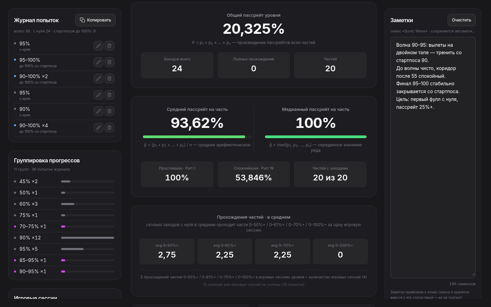

**Мобильная вёрстка** (390×844) — та же страница одной колонкой, панели
не переполняются, кнопки переносятся аккуратно:


Вся страница целиком, без прокрутки (1440×6122) —
[отдельный файл](screenshots/full-page.png).

---

## 2. Установка и запуск

### 2.1 Требования

| Компонент | Версия | Зачем |
|---|---|---|
| Node.js | 18, 20 или 22+ | Vite 6 требует `^18 \|\| ^20 \|\| >=22` |
| npm | 6+ (ставится с Node) | установка зависимостей, скрипты |
| ОС | Windows / macOS / Linux | Electron 44 |
| Geometry Dash + Geode + мод **Death Tracker** v2.x (elohmrow) | опционально | автосинхронизация попыток и авто-привязка уровней; без мода всё работает вручную |

> Сборка `dist/` **уже входит в архив** — для запуска приложения `npm run build`
> не нужен, достаточно `npm install` + `npm run electron:start`.

### 2.2 Быстрый старт из архива

```bash
# 1. Распаковать архив в НОВУЮ пустую папку
#    (не поверх старой версии! — см. типовые проблемы, п. 2.6)
unzip Geometry-Dash-Passrate-Tracker-with-dynamics.zip -d gd-tracker
cd gd-tracker

# 2. Установить зависимости (скачивает и бинарник Electron)
npm install

# 3. Запустить приложение
npm run electron:start
```

После первого окна можно сразу создавать сеанс: название уровня, стартовые
позиции (например `5, 10, 25, 50, 75`) — и вводить прогрессы.

> Если `npm install` падает на скачивании Electron (медленный/недоступный
> GitHub), можно повторить (`npm install` докачает), либо настроить зеркало
> `ELECTRON_MIRROR=https://npmmirror.com/mirrors/electron/ npm install`.

### 2.3 Режимы запуска

| Команда | Что делает | Когда использовать |
|---|---|---|
| `npm run electron:start` | Запускает Electron с готовой сборкой `dist/` | **Обычный запуск приложения** |
| `npm run electron:dev` | Vite dev-сервер + Electron с горячей перезагрузкой (`concurrently` + `wait-on`) | Разработка: правишь код — окно обновляется |
| `npm run dev` | Только веб-версия в браузере (`http://localhost:5173`) | Быстро посмотреть UI; мосты Electron (игра/мод) недоступны — панели честно сообщают об этом |
| `npm run build` | Проверка типов `tsc --noEmit` + сборка `vite build` → `dist/` | После правок исходников |
| `npm run preview` | Локальный сервер собранного `dist/` | Проверить production-сборку в браузере |

> **Важно для Electron**: `vite.config.ts` задаёт `base: './'` — относительные
> пути в `dist/index.html`, чтобы ассеты находились при загрузке через
> `file://` (`win.loadFile`). При сборке не менять.

### 2.4 Сборка дистрибутивов (инсталляторы)

Упаковка в нативные пакеты — [electron-builder](https://www.electron.build)
(конфиг — секция `build` в `package.json`, вывод в папку `release/`):

```bash
npm run dist:win    # NSIS-установщик x64: GD-Passrate-Tracker-Setup-1.21.0.exe
npm run dist:linux  # AppImage + deb: GD-Passrate-Tracker-1.21.0.*
npm run dist:mac    # dmg
npm run dist        # сборка + пакет для текущей платформы
```

В пакеты входят `dist/**`, `electron/**` и иконки `build/icon.png` +
`build/icon.ico`; `node_modules` не копируется (production-зависимостей у рендерера нет — весь UI
и логика сбандлены Vite в один JS).

**Иконки приложения.** Для Windows-сборки используется готовый
`build/icon.ico` — electron-builder берёт его **напрямую**, без PNG→ICO-конвертации
через WASM. Это не случайность, а фиксинг: встроенный конвертер при старте выделяет
**1 ГБ** WebAssembly-памяти, и на машинах с 32-битным Node.js или исчерпанным
лимитом (RAM + файл подкачки) выделение падает с ошибкой
`WebAssembly.Memory(): could not allocate memory` — сборка `dist:win` завершалась
крахом уже после упаковки exe, на последнем шаге иконки.

- `build/icon.ico` — иконка exe-файла и NSIS-установщика (многослойный: кадры
  16, 24, 32, 48, 64, 128, 256);
- `build/icon.png` (512×512) — исходник иконки, иконка окна Electron
  (читается из app.asar) и источник для Linux/macOS-сборок.

**Своя иконка** — замените оба файла: PNG квадратный, не меньше 256×256
(рекомендуется 512×512); ICO — многослойный, обязательно с кадром 256×256,
иначе electron-builder его отклонит. ICO можно получить из PNG одной командой:
`npx png-to-ico build/icon.png > build/icon.ico` (или любым онлайн-конвертером
«PNG → ICO»).

### 2.5 Где хранятся данные

Все данные — статистика сеансов, игровые сессии, заметки, настройки моста —
лежат в `localStorage` **окна Electron**, то есть в профиле приложения на
диске, и никак не привязаны к папке проекта:

| ОС | Путь профиля |
|---|---|
| Windows | `%APPDATA%\gd-passrate-tracker\` (например `C:\Users\<имя>\AppData\Roaming\gd-passrate-tracker`) |
| macOS | `~/Library/Application Support/gd-passrate-tracker/` |
| Linux | `~/.config/gd-passrate-tracker/` |

Следствия, которые удобно знать:

- **Перенос на другую машину/папку**: данные не теряются при переезде проекта
  — достаточно скопировать папку профиля. Переустановка/пересборка приложения
  статистику не трогает.
- **Отладка «с нуля»**: закрыть приложение и удалить (или переименовать) папку
  профиля — localStorage очистится, приложение стартует с пустым состоянием.
- **Ключи**: история хранится в `localStorage` под ключом
  `gd-passrate-tracker.v2` (старый одиночный формат `…v1` автоматически
  мигрируется, подробности — [раздел 6](#6-формат-сохранения)).

### 2.6 Типовые проблемы и решения

| Симптом | Причина | Решение |
|---|---|---|
| `tsc: не является внутренней или внешней командой` при `npm run build` | `npm install` не выполнен или упал | Запустить `npm install` до конца; проверить версию Node (`node -v` ≥ 18) |
| `TS2305: … math.ts не экспортирует PassAverage/ReachAverage` | Архив распакован **поверх старой версии** — в `src/components/` остались переименованные компоненты прошлых версий (`AveragePassesPanel.tsx`, `AverageReachesPanel.tsx`), а типов, которые они импортируют, в коде больше нет | Распаковать архив в чистую папку (надёжнее) или удалить два устаревших файла и запустить `npm run build` заново |
| `[gdGame] список процессов недоступен (tasklist/ps)…` в консоли | Опрос списка процессов временно не отвечает (антивирус, окружение, сбой команды) | Не критично: трекер продолжает работать, автоопределение запуска игры приостановлено. v1.14 сам пробует три способа (tasklist с полным окружением → tasklist со стройным → PowerShell) и печатает точную диагностику; обычно достаточно запустить от обычного пользователя и/или добавить исключение в антивирус |
| Подёргивания FPS в самой игре во время гринда | Исторически: опрос процессов и запись сохранения на каждую смерть | Исправлено (v1.15–v1.19): опрос процессов 20 с во время игры и с фильтром `/FI IMAGENAME`, запись localStorage с дебаунсом 2–10 с. Если осталось — почти наверняка антивирус сканирует файл сейва мода на каждую смерть: добавить папку `…/elohmrow.death_tracker/levels` в исключения проверки в реальном времени |
| Окно «зависает и исчезает» при развороте на весь экран, ~1 ГБ памяти | Краш GPU-процесса Chromium (exit_code=34) на части связок драйвер+Windows | Исправлено в v1.13: аппаратное ускорение отключено (`app.disableHardwareAcceleration()`), приложение работает софтверной композицией. Убедиться, что версия ≥ 1.13 |
| `exited with signal SIGINT` в PowerShell | Это Ctrl+C — штатное завершение | Ничего не делать |

---

## 3. Архитектура проекта

### 3.1 Общая картина

Приложение — одностраничник (SPA) на React, «посаженный» в оболочку Electron.
Логика делится на три мира по процессам:

- **Renderer** (процесс Chromium, `src/`) — весь интерфейс и **вся** бизнес-логика:
  хранение состояния, формулы, разбор ввода, группировки, реконструкция
  динамики. React-компоненты только отображают; вычисления живут в чистых
  модулях `src/utils/*` без побочных эффектов.
- **Preload** (`electron/preload.cjs`) — тонкий мост через `contextBridge`:
  публикует в страницу `window.gdDT` (мост к сейвам Death Tracker) и
  `window.gdGame` (статус запуска игры). Renderer изолирован
  (contextIsolation + sandbox) — Node со страницы недоступен.
- **Main** (`electron/main.cjs`, `electron/gameWatcher.cjs`) — окно, меню,
  файловая система и процессы ОС. Main намеренно «глупый»: он читает/
  парсит JSON мода и опрашивает процессы, ничего не зная про сеансы и формулы.

Пары IPC-каналов (контракты описаны интерфейсами `GdDTApi` / `GdGameApi` в
`src/utils/dtSync.ts` и `src/utils/gameWatch.ts`):

| Канал | Направление | Смысл |
|---|---|---|
| `gdDT:configure` / `gdDT:disable` | invoke | Подключить/отключить наблюдение за папкой уровней мода |
| `gdDT:pickFolder` / `gdDT:autoscan` | invoke | Системный диалог выбора папки / поиск папки мода в типичных местах |
| `gdDT:readLevel` | invoke | Сырой JSON файла уровня (для импорта истории) |
| `gdDT:event` | main → renderer | Поток событий моста: изменения файлов, статусы |
| `gdGame:status` | invoke | Игра запущена сейчас? с какого момента? |
| `gdGame:event` | main → renderer | Игра запустилась / закрылась; здоровье наблюдателя |

### 3.2 Схема

```
┌────────────────────────────── ОС ──────────────────────────────────────┐
│                                                                        │
│   Geometry Dash (Steam) + Geode + мод Death Tracker     прочие процессы │
│        │  переписывает JSON уровня                      │               │
│        │  на каждую смерть/ран                           │               │
│        ▼                                                ▼               │
│   <папка мода>/levels/*.json                    tasklist / ps /         │
│                                                 powershell (список      │
│                                                 процессов)              │
└────────┬──────────────────────────────┬──────────────────┬──────────────┘
         │ fs.watch + дебаунс-скан      │                  │
         ▼                              │                  │
┌── Electron MAIN (Node.js, electron/) ─┴──────────────────┴──────────────┐
│                                                                          │
│  main.cjs                                gameWatcher.cjs                 │
│  ├ окно BrowserWindow (1440×900,        ├ опрос процессов: 2 с вне     │
│  │  без GPU-ускорения)                  │  игры / 20 с во время игры   │
│  ├ меню, диалоги выбора папки           │  + фильтр /FI IMAGENAME      │
│  ├ наблюдение папки уровней мода        ├ лестница стратегий: tasklist │
│  │  (SCAN_DEBOUNCE_MS = 1000,           │  (полное окружение) →        │
│  │  перескан 15 с/5 с)                  │  tasklist (стройное окр.) →  │
│  ├ дифф не делает — только события      │  PowerShell Get-Process      │
│  └ страховки: uncaughtException,        ├ экспон. бэкофф 2→30 с       │
│     render-process-gone → reload        └ события started/stopped      │
│                                          + health (degraded, detail)  │
└────────┬──────────────────────────┬────────────────────────┬────────────┘
         │ IPC: gdDT:*/gdDT:event   │ IPC: gdGame:status/     │
         │                          │       gdGame:event      │
┌────────▼──────────────────┌───────▼────────────────────────┴────────────┐
│        PRELOAD             │   window.gdDT · window.gdGame              │
│  (contextBridge, sandbox)  │   (единственные Electron-API со страницы)  │
└────────┬───────────────────┴──────────────┬─────────────────────────────┘
         ▼                                   ▼
┌── RENDERER (Chromium, src/, React 19 + TS) ─────────────────────────────┐
│                                                                          │
│  App.tsx — единственный владелец состояния:                             │
│    sessions / activeId / gameSessions / dtConfig / undo-стек            │
│    · persist: debounce 2 с (10 с при скрытом окне) + flush на pagehide  │
│    · подписка на gdGame/gdDT, сверка восстановленных игровых сессий     │
│                                                                          │
│  components/* (27 шт.) — только отображение и ввод                      │
│      SessionBar · AttemptInput · AttemptLog · ProgressGroups            │
│      GameSessionsPanel · GameSessionDetailModal · DeathTrackerSync      │
│      TotalPassrate · AveragePartPassesPanel · TotalModelComparison      │
│      SectionPassrate · LevelMap · PartCard · DynamicsPanel · LineChart  │
│      ImportModal · NewSessionModal · StartPosSetup · NotesPanel …       │
│                                                                          │
│  utils/* — чистые функции (без React, без побочных эффектов):           │
│    math.ts      формулы 1–3, модели, участки, группировка, формат       │
│    parse.ts     разбор стартпосов/прогрессов/столбиков                  │
│    dynamics.ts  реконструкция истории пассрейта из журнала              │
│    gameWatch.ts игровые сессии: стор статуса, группировка, средние      │
│    dtSync.ts    дифф снапшотов Death Tracker, фильтры ранов             │
│                                                                          │
│  localStorage «gd-passrate-tracker.v2» (ключ), миграция из v1           │
└──────────────────────────────────────────────────────────────────────────┘
```

### 3.3 Правила слоёв

Чтобы проект оставался предсказуемым, код следует нескольким жёстким правилам:

1. **Вся логика — в renderer, в `src/utils/*`.** Main не знает про сеансы,
   формулы и пассрейт; он лишь «глаза» (процессы) и «уши» (файлы мода).
   Благодаря этому вся бизнес-логика работает и в веб-версии, и её можно
   тестировать обычным Node без Electron.
2. **`utils/*` — чистые функции.** Никакого React, никакого состояния: на вход
   данные, на выход новые данные (иммутабельно, вход не мутируется). Все
   счётные функции (`applyAttemptFrom`, `groupLogAttempts`, `computeDynamics`,
   `averagePartPasses`, `collectGameSessionProgress`, …) покрыты юнит-тестами
   именно потому, что они изолированы.
3. **`components/*` — только отображение.** Единственный «умный» компонент —
   `App.tsx`: он владеет состоянием, применяет действия через обработчики
   и прокидывает данные вниз пропсами. Модалки (`DynamicsPanel`,
   `GameSessionDetailModal`, `ImportModal`, `NewSessionModal`) получают данные
   снапшотом и живут, пока открыты.
4. **Иммутабельность данных.** `Part[]` — Read-only-массивы: любое действие
   над счётчиками возвращает новый массив (`parts.map(...)`), старый остаётся
   ссылкой для React и undo-снапшотов. То же в утилитах группировок и
   сортировок (`slice()` перед `sort()`).
5. **Контракты IPC — типизированные интерфейсы** (`GdDTApi`, `GdGameApi`) с
   `declare global` для `window`. Renderer проверяет наличие моста
   (`window.gdDT !== undefined`), а не платформу — в браузере панели сами
   переключаются на честные «работает только в приложении».
6. **Экономия главного потока.** Всё, что тикает, — с умным темпом: тикеры
   длительностей 5 с и засыпают при скрытом окне, сохранение с дебаунсом,
   журнал рендерит окно в 150 строк. Игрок в этот момент играет — трекер не
   должен отнимать кадры (история оптимизаций — п. 3.7).

### 3.4 Поток данных одной попытки

Разберём ввод «63» в панель «Новая попытка» от нажатия Enter до экрана:

```
пользователь: «63», Enter
   │
   ▼ parse.ts: parseAttemptSpec
AttemptSpec { from: 0, to: 63, times: 1, at: Date.now() }   ← метка времени (с v1.10)
   │
   ▼ App.tsx: handleAddAttempt
   ├── undo-стек: снапшот { parts, fullClears, log } ДО действия (≤50 шагов)
   ├── log = [...log, spec]                                  ← журнал пополнился
   └── parts = applyAttemptFrom(parts, 0, 63)                ← Формула 3 (иммутабельно)
   │
   ▼ useMemo-пересчёт (App.tsx)
passrates = parts.map(partPassrate)                          ← Формула 1
total = totalPassrate(parts)                                 ← Формула 2
passStats = averagePartPasses(log, gameSessions)             ← средние по игровым сессиям
   │
   ▼ React re-render
TotalPassrate · PartCard × N · SectionPassrate × 2 · LevelMap ·
TotalModelComparison · AveragePartPassesPanel · GameSessionsPanel(запись легла
в открытую игровую сессию — если игра запущена) · ProgressGroups · журнал
   │
   ▼ трейлинг-дебаунс 2 с (10 с, если окно скрыто игрой)
JSON.stringify(PersistedState) → localStorage.setItem('gd-passrate-tracker.v2')
   (pagehide/beforeunload/visibilitychange → мгновенный flush — ничего не теряется)
```

Раны со стартпозов («30-100») идут тем же путём, но `from = 30` — вклад
начинается с части, содержащей 30% (см. [формулу 3](#57-общий-пассрейт-и-формулы)).

### 3.5 Инвариант счётчиков — фундамент всего

Весь проект держится на одном равенстве:

```
parts = «Добавлено ранее»  +  Σ applyAttemptFrom(запись) × times   по журналу
```

Счётчики любой части — это сумма вкладов всех записей журнала плюс «до-журнальный»
остаток (то, что накапало до v1.4, когда история вводов ещё не сохранялась).
Обратная операция `unapplyAttemptFrom` — **точная инверсия**:
`unapply(apply(parts, spec), spec) = parts`.

Из этого одного равенства следуют сразу несколько фич «бесплатно»:

| Что | Как следует из инварианта |
|---|---|
| **Undo / сброс** | снапшоты хранят `parts`/`log` до действия — откат в прошлое всегда консистентен |
| **Правка/удаление записи журнала** | «вычесть старый вклад, прибавить новый»: `unapply(old) → apply(new)` — счётчики пересчитываются точно, без полного пересчёта |
| **«Добавлено ранее»** | `earlierProgress()` вычитает вклад журнала из инвариантов счётчиков (`attempts` первой части = все попытки с нуля; `clears` последней = все раны до 100%) и показывает до-журнальные итоги |
| **Графики динамики** | вычесть весь журнал → состояние «до журнала», затем переиграть записи по одной → точная история пассрейтов без отдельного накопления снапшотов (`utils/dynamics.ts`) |
| **Самопроверка** | последняя точка графика динамики обязана совпадать с текущей статистикой — расхождение сразу видно |

### 3.6 Модель данных

Все типы — в `src/types.ts`, с документацией каждого поля. Краткая карта:

```ts
Part { id, start, end, clears, attempts }      // часть уровня между стартпосами
AttemptSpec { from, to, times, at? }           // запись журнала: старт→финиш ×N, метка времени
Session {                                      // сеанс = уровень целиком
  id, name, createdAt,
  startPosInput,        // сырой текст стартпосов «5, 10, 25, 50, 75»
  parts: Part[],        // счётчики = «Добавлено ранее» + Σ вкладов журнала
  fullClears?,          // раны 0→100% (отдельный счётчик с v1.3)
  log?: AttemptSpec[],  // журнал вводов (с v1.4), хронологический
  dtSync?: DtSyncLink,  // привязка к файлу уровня Death Tracker (с v1.7)
  notes?: string        // заметки игрока (с v1.9)
}
DtSyncLink { levelKey, levelName, seen: { deaths, runs }, linkedAt }
DtBridgeConfig { folder, enabled, includeRuns, startposOnly, autoLink }
GameSession { id, startedAt, endedAt | null }  // запуск игры → закрытие (с v1.12)
```

Плюс персистентная обёртка `PersistedState { sessions, activeId, dtBridge,
gameSessions }` в `App.tsx`. Необязательные поля — это «мягкие миграции»:
старое сохранение без поля загружается, поле достраивается дефолтом
(например, `fullClears` мигрирует из `clears` последней части), формат
хранилища с v1.2 по v1.21 не менялся деструктивно ни разу.

### 3.7 Производительность и стабильность

Значительная часть кода — ответы на реальные жалобы (фризы в игре при гринде,
«гигабайт памяти», краш окна на весь экран). Что сделано и почему:

**В Electron (main):**

- `app.disableHardwareAcceleration()` — интерфейс это текст и SVG; софтверная
  композиция стабильнее: исчез GPU-процесс Chromium, который на части связок
  «драйвер+Windows» падал при развороте окна (exit_code=34), а циклы его
  перезапуска разгоняли память до гигабайта.
- `--max-old-space-size=256` — потолок V8-кучи: по умолчанию V8 размерирует её
  от объёма машины и «на всякий случай» не возвращает системе. Состояние
  трекера — мегабайты JSON и ~150 DOM-строк, 256 МБ — с запасом; внутри
  потолка GC уплотняет память, типичный RSS ниже на десятки МБ.
- Опрос процессов игры **асимметричный**: 2 с, когда игра закрыта (ловим запуск),
  20 с, когда играет (ловим закрытие — сессии длятся десятки минут, +20 с
  несущественны). Каждый опрос — спавн системной команды: во время игры их
  стало в 10 раз меньше.
- Во время игры tasklist зовётся **с фильтром** `/FI "IMAGENAME eq
  GeometryDash.exe"` — вывод сжимается с сотен строк до одной.
- **Лестница стратегий** опроса (tasklist с наследованным окружением →
  tasklist со «стройным» → PowerShell) с залипанием на работающей и
  экспоненциальным бэкоффом при сбоях (2→4→8→16→30 с, сброс при успехе).
- Страховочные сетки: `uncaughtException` / `unhandledRejection` логируются,
  но не роняют процесс; падение renderer (`render-process-gone`) перезагружает
  страницу вместо мёртвого окна.
- Скан файлов мода с **дебаунсом 1000 мс** (мод пишет JSON на каждую смерть;
  смерти склеиваются в батчи, дифф по снимкам корректно раскладывает их в «×N»).

**В renderer:**

- Сохранение — **трейлинг-дебаунс 2 с** (10 с при скрытом окне; пропущенное
  добирается catch-up'ом моста) и мгновенный flush на `pagehide` /
  `beforeunload` — JSON.stringify всего состояния на главном потоке при
  гринде успевал случаться каждые ~0,5 с и ронял кадры в игре.
- Журнал рендерит окно **последних 150 записей** (`RENDER_LIMIT`) — при живой
  синхронизации с модом журнал растёт с каждой смертью; «Показать все»
  разворачивает список, индексы правки/удаления пересчитываются в координаты
  полного журнала.
- Тикеры длительностей — 5 с и **засыпают при `document.hidden`**: секунды
  всё равно не видны за игрой на весь экран, а renderer не просыпается.
- Вычисления (пассрейты, средние, динамика) — в `useMemo` от конкретных
  данных, а не на каждый рендер.
- `backdrop-filter` убран из всех панелей (десятки полупрозрачных
  blur-поверхностей — дорогие GPU/compositor-слои; на тёмном статичном фоне
  разницы не видно).

---

## 4. Устройство проекта (файлы)

```
Geometry-Dash-Passrate-Tracker-main/
├── package.json            # скрипты, зависимости, конфиг electron-builder
├── package-lock.json
├── tsconfig.json           # strict TypeScript, include: src
├── vite.config.ts          # React + Tailwind v4 плагины, base './' для file://
├── index.html              # точка входа SPA (тёмная тема, favicon.svg)
├── build/icon.png          # исходник иконки (окно Electron, Linux/macOS)
├── build/icon.ico          # готовая иконка exe/установщика Windows (кадры 16…256)
├── public/favicon.svg
├── screenshots/           # скриншоты интерфейса для этого README (v1.28–v1.29,
│                          #   12 PNG: десктоп 1440 и мобильный 390)
├── dist/                   # ГОТОВАЯ СБОРКА (уже в архиве): index.html + assets/index-*.js
│
├── electron/               # ── main-процесс (Node.js, CommonJS) ──
│   ├── main.cjs            # окно/меню/IPC, наблюдение файлов мода, страховки
│   ├── preload.cjs         # contextBridge → window.gdDT / window.gdGame
│   └── gameWatcher.cjs     # отслеживание запуска/закрытия Geometry Dash
│
└── src/                    # ── renderer (React 19 + TS) ──
    ├── main.tsx            # корень React
    ├── App.tsx             # состояние, persist, undo, обработчики, layout
    ├── types.ts            # модель данных (Part, AttemptSpec, Session, …)
    ├── index.css           # тема «Geometry Dash»: неон, panel/btn-классы
    ├── fonts.css           # локальные woff2 (Baloo 2 / Rubik) — оффлайн-режим
    ├── assets/fonts/*.woff2
    ├── vite-env.d.ts
    │
    ├── utils/              # ── чистая логика (тестируется Node-скриптами) ──
    │   ├── math.ts         # формулы 1–3, модели, участки, «Добавлено ранее»,
    │   │                   # группировка журнала, тренировка Blitzkrieg,
    │   │                   # форматирование (русская локаль)
    │   ├── parse.ts        # разбор стартпосов, прогрессов, «30-100 x5», столбиков
    │   ├── dynamics.ts     # реконструкция истории пассрейтов из журнала
    │   ├── gameWatch.ts    # игровые сессии: стор статуса, группировка,
    │   │                   # средние части, окно сессии, сортировка (v1.21)
    │   └── dtSync.ts       # Death Tracker: парсинг JSON мода, дифф, фильтры
    │
    └── components/         # ── панели UI (только отображение) ──
        ├── SessionBar.tsx             # переключение/создание/удаление сеансов
        ├── NewSessionModal.tsx        # создание/правка сеанса
        ├── StartPosSetup.tsx          # стартовые позиции, разбивка на части
        ├── AttemptInput.tsx           # ввод попытки + импорт/графики/undo/сброс
        ├── ImportModal.tsx            # импорт столбиком (+ Drag&Drop файла)
        ├── FileTextarea.tsx           # поле с чтением файла в ImportModal
        ├── AttemptLog.tsx             # журнал попыток (правка/удаление/копия)
        ├── ProgressGroups.tsx         # группировка одинаковых прогрессов
        ├── GameSessionsPanel.tsx      # игровые сессии (+ бейдж статуса игры)
        ├── GameSessionDetailModal.tsx # окно одной игровой сессии (v1.20/v1.21)
        ├── DeathTrackerSync.tsx       # панель моста к моду (привязка/лента)
        ├── LevelSearchSelect.tsx      # поиск уровня мода с клавиатурой
        ├── TotalPassrate.tsx          # общий пассрейт уровня
        ├── AveragePartPassrate.tsx     # средний и медианный пассрейт на часть (Формулы 2а/2б, v1.25/v1.28)
        ├── AveragePartPassesPanel.tsx # средние прохождения частей 0–50/61/70%+
        ├── TotalModelComparison.tsx   # сравнение с моделями 50/60/70/80%
        ├── SectionPassrate.tsx        # пассрейт участка 0–70% / 0–50%
        ├── LevelMap.tsx               # карта уровня с подсветкой частей
        ├── BlitzkriegPanel.tsx        # тренировка кусковыми стадиями (v1.24, порядок — v1.29)
        ├── PartCard.tsx               # карточка одной части
        ├── DynamicsPanel.tsx          # модалка графиков динамики
        ├── LineChart.tsx              # SVG-график без зависимостей
        ├── NotesPanel.tsx             # заметки к уровню
        └── Modal.tsx                  # базовая модалка (Esc/фон, wide)
```

Вёрстка — `App.tsx`, сетка `grid lg:grid-cols-[21rem_1fr] xl:…[21rem_1fr_18rem]`:
левый aside (журнал → группировка → игровые сессии → мост мода), центр
(настройка → ввод → статистика), правый aside (заметки); боковые колонки
«прилипают» при прокрутке, на `lg` правая уезжает под контент. Панели —
единый класс `.panel` из `index.css` (тёмное «стекло» без backdrop-blur,
см. п. 3.7), кнопки — `.btn-neon` / `.btn-ghost`; шрифты Baloo 2/Rubik лежат
локально, чтобы десктоп-приложение не ходило в сеть.

---

## 5. Возможности: как работает каждая фича

### 5.1 Сеансы уровней

**UI:** панель `SessionBar` сверху — чипы уровней с текущим общим пассрейтом,
кнопки «+» (создать), правка (карандаш), удаление (двухшаговое подтверждение —
первый клик «оружуется», второй удаляет, через 5 с сбрасывается).

**Как работает.** Сеанс (`Session`) — один уровень со своей разбивкой на части
и всей статистикой. Сеансов можно вести сколько угодно параллельно и
переключаться; активный запоминается в сохранении (`activeId`), при запуске
открывается последний. Всё состояние всех сеансов живёт в одном объекте
`PersistedState` и в одном ключе localStorage (история форматов — [раздел 6](#6-формат-сохранения)).

Смена разбивки стартпосов не уничтожает статистику: если границы частей
совпали с прежними, счётчики остаются (сравнение через `sameBoundaries` в
`parse.ts`); при изменении структуры панель настройки честно предупреждает,
что части пересоздадутся (счётчики обнулятся, журнал останется). Удаление
сеанса удаляет и его журнал, но не трогает игровые сессии — они глобальны.

**Код:** `components/SessionBar.tsx`, `components/NewSessionModal.tsx`
(создание/правка: имя + стартпосы + поиск уровня мода для привязки),
`App.tsx` (`handleSessionSubmit`, `handleSelectSession`, `handleDeleteSession`).

### 5.2 Разбивка уровня на части

**UI:** `StartPosSetup` — поле «Стартовые позиции» (`5, 10, 25, 50, 75`),
кнопка «Сгенерировать равные части» (на N частей).

**Как работает.** `parseStartPositions` (`utils/parse.ts`) принимает числа
через запятые/точки с запятой/пробелы/переводы строк в любых комбинациях,
игнорирует значения вне (0, 100) (0% и 100% добавляются автоматически),
убирает дубликаты, сортирует по возрастанию, дробные — через точку
(например `62.5`). Каждая пара соседних границ + 0 и 100 даёт `Part`:
части покрывают [0, 100] без пропусков и перекрытий.

Почему части — это стартпосы: в GD новая попытка стартует либо с нуля, либо
со стартовой позиции; границы частей — ровно те точки, откуда бывают старты.
Пассрейт части тогда имеет честный смысл: доля заходов, «проехавших» этот
отрезок целиком (об инвариантах — п. 3.5).

**Код:** `utils/parse.ts`, `components/StartPosSetup.tsx`, `App.tsx`
(`handleStartPosChange`, `handleGenerate`).

### 5.3 Ввод попыток и «Отменить»

**UI:** `AttemptInput` над статистикой — неоновое поле с Enter-добавлением,
подсказки валидных форм, ряд действий: «Импорт», «Графики динамики»,
«Отменить», «Сбросить».

**Как работает.** Поле понимает три формы (разбор — `parseAttemptSpec` в
`parse.ts`):

| Ввод | Что значит | Разбирается в |
|---|---|---|
| `63` | попытка с нуля, умер на 63% | `from: 0, to: 63, times: 1` |
| `30-100` | ран со стартпоса 30% до конца | `from: 30, to: 100, times: 1` |
| `40 x3` / `40 ×3` | три одинаковые подряд | `times: 3` |

Дробные — через точку или запятую (`62,5`); разделитель диапазона — дефис;
`x`/`×`/`*` — множитель. Валидация: `to` ≤ 100, `from` должен быть 0 или
границей части (иначе подсвечивается ошибка — старт «из середины части»
невозможен в GD, см. `isStartBoundary`).

Каждое действие (ввод, импорт, правка, удаление, применение событий мода)
кладёт в undo-стек снапшот `{ parts, fullClears, log }` **до** изменения
(глубина — 50 шагов). «Отменить» откатывает последнее действие целиком.
«Сбросить» обнуляет счётчики и журнал сеанса (с двухшаговым подтверждением) —
undo работает и на него, заметки не трогает.

**Код:** `components/AttemptInput.tsx`, `utils/parse.ts`, `App.tsx`
(`handleAddAttempt`, `handleUndo`, `handleReset`, undo-стек `Snapshot[]`).

### 5.4 Импорт из столбика

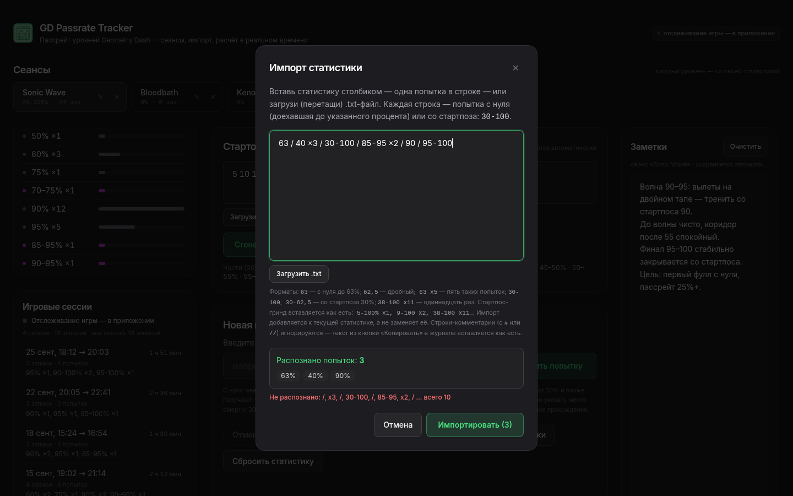

**UI:** кнопка «Импорт» → модалка `ImportModal`: многострочное поле,
кнопка «Выбрать .txt» (или перетащить файл в поле), предпросмотр разбора,
сводка «N записей · M попыток», кнопка «Импортировать».

**Как работает.** `parseAttemptList` читает столбик строк — по одной попытке
на строку (`63`, `30-100 x5`, `62.5`), пустые строки и комментарии (строки,
начинающиеся с `#` или `//`) пропускает. Файл `.txt` читается в браузере
(`FileReader` в `FileTextarea`) — путь никуда не отправляется. Импорт
применяется как одно действие: все записи за раз (один шаг undo), каждая
запись получает метку времени `at = Date.now()`.

Формат круглый: столбик, скопированный из журнала кнопкой «Копировать»
(там же комментарии-шапка и итог «Добавлено ранее»), вставляется обратно без
предупреждений — так статистика переносится между сеансами и машинами.
Невалидные строки показываются списком с номерами строк, импорт не
происходит, пока они не исправлены.

**Код:** `components/ImportModal.tsx`, `components/FileTextarea.tsx`,
`utils/parse.ts`, `App.tsx` (`handleImport`).

### 5.5 Журнал попыток

**UI:** левый aside, `AttemptLog` — хронологический столбик всех вводов:
прогресс моно-шрифтом, точка-маркер типа записи (с нуля / стартпос / фулл),
кнопки правки (разворачивает запись в поле ввода) и удаления, счётчики
сводки, «Копировать».

**Как работает.** Журнал (`Session.log`, с v1.4) — история вводов: одна запись
на каждый ввод/строку импорта/событие мода. Правка записи работает через
инвариант: старый вклад вычитается (`unapplyAttemptFrom`), новый прибавляется
(`applyAttemptFrom`) — счётчики сходятся точно, метка `at` сохраняется.
Удаление — просто вычитание вклада. Кнопка «Копировать» собирает текст
`buildJournalText` (математика): шапка-комментарий, записи в формате ввода,
итог «Добавлено ранее» — того, что накопилось до появления журнала (детальной
истории для него не сохранялось).

При большом журнале (живая синхронизация с модом пишет запись на каждую
смерть) список рендерит окно последних 150 записей и строку
«показаны последние 150 из N» с кнопкой «Показать все» — DOM не раздувается
(п. 3.7). «Добавлено ранее» — блок с итогами (`earlierProgress`):
попытки с нуля без фуллов, фуллы 0–100%, раны стартпос→100%, вычисленные
вычитанием вклада журнала из инвариантов счётчиков.

**Код:** `components/AttemptLog.tsx`, `utils/math.ts` (`earlierProgress`,
`buildJournalText`, `formatAttemptSpec`), `App.tsx` (`handleEditLogEntry`,
`handleDeleteLogEntry`).

### 5.6 Группировка прогрессов

**UI:** под журналом, `ProgressGroups` — «9% ×3, 18% ×2, 32% ×1 …»:
строка = маркер типа + моно-текст группы + полоса-гистограмма (доля от самой
частой группы), заголовок «N групп · M попыток» (с русскими формами
множественного числа).

**Как работает.** `groupLogAttempts` (`utils/math.ts`) сворачивает журнал по
точной паре `(from, to)`: «9, 9, 9» (три записи) и «9 ×2» (одна с
множителем) дают одну группу «9% ×5». Порядок — по возрастанию прогресса
`to`, затем по старту `from`. Полоса гистограммы — `count / max(count)` по
всем группам, цвет — по типу записи (с нуля / стартпос). Пример из запроса
пользователя: `9, 9, 9, 18, 18, 32, 56, 56, 70` → «9% ×3, 18% ×2, 32% ×1,
56% ×2, 70% ×1» — ровно панели слева, под журналом, обновляется мгновенно
при каждом вводе/правке.

**Код:** `components/ProgressGroups.tsx`, `utils/math.ts`
(`groupLogAttempts`, `formatGroupedAttempt`).

### 5.7 Общий пассрейт и формулы

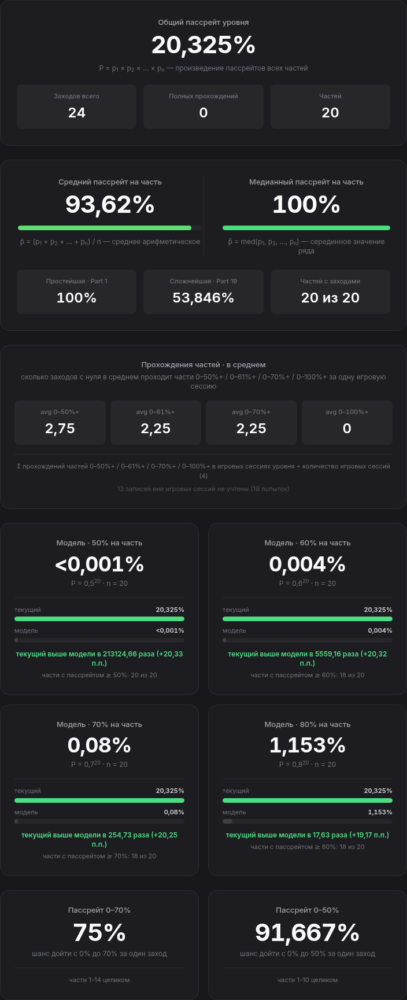

**UI:** центральная колонка: `TotalPassrate` (крупное неоновое число — общий
пассрейт уровня, количество попыток, фуллы, число частей), ниже —
`AveragePartPassrate` (две метрики на одной панели: средний пассрейт на часть
— среднее арифметическое, и медианный — серединное значение ряда, v1.28;
общие min/max-части и «частей с заходами»), ещё ниже —
пассрейты участков, карта, карточки частей.

**Как работает.** Три формулы ТЗ (реализация — `utils/math.ts`):

**Формула 1 — пассрейт части:**

```
p_i  = clears_i / attempts_i          (доля 0..1)
p_i% = clears_i / attempts_i × 100%
```

`attempts = 0` → пассрейт 0 (часть не заходили, защита от деления на ноль).
Внутри кода везде доли; в проценты — только при выводе (`formatPercent`:
до 3 знаков, запятая как разделитель, `<0,001%` для мелких).

**Формула 2 — общий пассрейт уровня:**

```
P = p_1 × p_2 × … × p_n
```

Произведение, потому что для фулла нужно пройти **все** части подряд; любая
часть без заходов (p_i = 0) обнуляет произведение. Произведение падает
экспоненциально с ростом n: при 4 частях «60% каждая» даёт 0,6⁴ = 12,96% —
это норма, а не баг (см. [модели](#510-модели-общего-пассрейта)).

**Формула 2а — средний пассрейт на часть** (`averagePassrate`, v1.25):

```
P_avg = (p_1 + p_2 + … + p_n) / n
```

Среднее арифметическое пассрейтов всех частей — панель
`AveragePartPassrate` сразу под общим пассрейтом. Произведение (Формула 2)
отвечает на вопрос «каков шанс пройти ВЕСЬ уровень за один заход», среднее —
«насколько части проходятся по отдельности». Части без заходов (p_i = 0)
входят в сумму честным нулём; среднее всегда ≥ произведения (среднее
арифметическое ≥ геометрического), и разрыв между ними показывает неровность
уровня: одна сложная часть обрушивает произведение, почти не трогая среднее.
В панели: цветная полоса среднего (шкала карточек частей), простейшая и
сложнейшая части (min/max — разброс вокруг среднего), число частей с заходами.

**Формула 2б — медианный пассрейт на часть** (`medianPassrate`, v1.28):

```
P_med = med(p_1, p_2, …, p_n)
```

Медиана — серединное значение отсортированного ряда пассрейтов частей:
при нечётном n — элемент ровно в середине ряда, при чётном — полусумма
двух средних. Показывается на ОДНОЙ панели со средним (v1.28): обе метрики —
одинаковые карточки рядом, каждая со своим числом, цветной полосой и
формулой. Среднее чувствительно к выбросам (одна аномально лёгкая часть
тянет его вверх, сложная — вниз), медиана — пассрейт ТИПИЧНОЙ части,
устойчива к выбросам, пока их меньше половины ряда. Разрыв между ними —
маркер асимметрии: среднее заметно ниже медианы — уровень портят несколько
очень сложных частей; выше — есть аномально лёгкие; совпадают — ряд
пассрейтов симметричен, «ровный» уровень. Ячейки «простейшая/сложнейшая
часть» и «частей с заходами» внизу панели — общие для обеих метрик.

**Формула 3 — вклад одной попытки в счётчики** (`applyAttemptFrom`,
`from → to`):

```
i0 = часть, начинающаяся на from;  k = часть, где закончилась попытка
• части до i0          — не тронуты (попытка стартовала позже)
• части i0..k−1        — clears +1 И attempts +1 (пройдены насквозь)
• часть k              — attempts +1 (начата, не пройдена)
• to = 100%            — все части от i0 до конца: clears +1 И attempts +1
```

Пример: стартпосы 25/50/75, попытка «30-63» → P2 (25–50) +1/+1, P3 (50–75)
только заход, P1/P4 не тронуты. Обратная `unapplyAttemptFrom` — та же схема
с минусами и множителем ×N; вместе они дают [инвариант](#35-инвариант-счётчиков--фундамент-всего).

Инвариант Формулы 3 гарантирует `p_i ≤ 1` у каждой части: любой заход либо
проходит часть насквозь (тогда `clears +1` **вместе с** `attempts +1`), либо
умирает внутри неё (только `attempts +1`) — по построению `attempts_i ≥
clears_i`, значит общий пассрейт всегда лежит в [0, 100%]. Счётчики рядом с
ним (попытки, фуллы) — абсолютные числа и растут неограниченно; фуллы с
нуля ведутся отдельным счётчиком `fullClears` с v1.3, потому что `clears`
последней части включает и стартпос-фуллы, и их больше нельзя использовать
как «полные прохождения с нуля».

**Код:** `utils/math.ts` (`partPassrate`, `totalPassrate`, `averagePassrate`,
`medianPassrate`, `applyAttemptFrom`, `unapplyAttemptFrom`, `findPartIndex`,
`isStartBoundary`), `components/TotalPassrate.tsx`,
`components/AveragePartPassrate.tsx`.

### 5.8 Пассрейт участков 0–70% и 0–50%

**UI:** две панели `SectionPassrate` — «шанс доехать с нуля до 70% / 50%».

**Как работает.** `sectionPassrateFromZero(parts, x)` — то же произведение
Формулы 2, но не по всем частям, а по участку [0%, x%]:

- части, лежащие в участке целиком (`end ≤ x`), входят целиком;
- если x совпадает с границей части — значение **точное**;
- если x **внутри** части k — детальной статистики по куску нет, поэтому часть
  учитывается пропорционально пройденной доле: `p_k^f`,
  `f = (x − start_k)/(end_k − start_k)` — допущение «постоянного риска внутри
  части» (интерполяция в логарифмической шкале между 1 на старте части и
  p_k на её конце).

Панель показывает и «нижнюю опору» `boundaryValue` — вероятность дойти до
последней границы части перед отметкой (не зависит от допущения), и пометку,
какая часть учтена приближённо. Значение монотонно убывает с ростом x —
смерть не добавляет шансов.

**Код:** `utils/math.ts` (`sectionPassrateFromZero`, `SectionPassrate`),
`components/SectionPassrate.tsx`.

### 5.9 Карта уровня и карточки частей

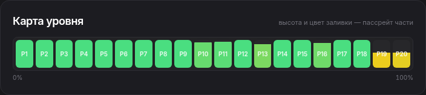

**UI:** `LevelMap` — горизонтальная полоса 0–100% с подсвеченными частями
(цвет — по пассрейту, от красного к зелёному, `passrateColor`); под ней —
сетка карточек `PartCard`: номер, диапазон «50–75%», clears/attempts,
пассрейт с цветной полосой.

**Как работает.** Карта — наглядный ответ на «какая часть валит»: ширина
блока части пропорциональна её длине в процентах, цвет — пассрейту
(hsl-интерполяция 0→красный, 100%→зелёный). Карточка пересчитывается
мгновенно (данные — пропсы из `useMemo` App). Пустая часть (0 заходов)
показывается честно нулём. Карточки — единственное место, где по частям
видны и абсолютные числа, и доли одновременно, что удобно для сверки
с формулой вручную.

**Код:** `components/LevelMap.tsx`, `components/PartCard.tsx`,
`utils/math.ts` (`passrateColor`, `formatRange`).

### 5.10 Модели общего пассрейта

**UI:** блок из четырёх панелей `TotalModelComparison` под общим пассрейтом —
уровни 50% / 60% / 70% / 80% (сетка 2×2 → 4 в ряд на широких экранах).

**Как работает.** Модель — «эталон для сравнения»: каким был бы общий пассрейт,
если бы **каждая** часть проходилась одинаково (`modelTotalPassrate`):

```
P_model = level^n,   level ∈ {0.5, 0.6, 0.7, 0.8},  n — число частей
```

Смысл: произведение Формулы 2 экспоненциально чувствительно к слабому звену.
0,5⁴ = 6,25%, 0,8⁴ = 40,96% — разброс в 6,5 раза при «полезных» пассрейтах
частей. Сравнение факта с моделями показывает, насколько **неравномерность**
частей (обычно ранние легче, финал сложнее) лучше или хуже ровного
распределения. В каждой панели: модельное значение (крупное число), полосы
«текущий» (неоновая) и «модель» (серая) на общей шкале блока, итог сравнения
(«выше модели в N раз (+X п.п.)» — emerald, «ниже модели…» — rose) и счётчик
«части с пассрейтом ≥ N%: k из m». Пустой сеанс/нет частей — панель честно
молчит (модель не определена).

**Код:** `components/TotalModelComparison.tsx`, `utils/math.ts`
(`modelTotalPassrate`).

### 5.11 Средние прохождения частей

**UI:** `AveragePartPassesPanel` сразу под общим пассрейтом — три ячейки
`avg 0–50%+ / avg 0–61%+ / avg 0–70%+` с тултипами-разборами и строкой
формулы.

**Как работает.** Метрика: сколько заходов с нуля в среднем проходят каждую
«часть от нуля» за одну **игровую** сессию. Часть 0–X%+ — отрезок [0%, X%],
покрыть его можно только целиком, поэтому (v1.17+):

```
прохождение части 0–X%+ :  from = 0  И  to ≥ X        (countLogPartPasses)
avg = Σ прохождений в игровых сессиях уровня  ÷  количество этих сессий
```

Границы взяты буквально `[50, 61, 70]` (константа `PASS_PART_ENDS`): смерть
ровно на 50% — прохождение части 0–50%+ (доехал вплотную), смерть на 60% —
НЕ прохождение 0–61%+ (до конца не доехал). Раны со стартпозов не считаются
в принципе: 30–63% не покрывает отрезок от нуля, даже стартпос-фулл 50–100%
не проходит 0–50%+. Фулл 0–100% проходит все части; множители ×N — целиком.

Данные и знаменатель (v1.18+): журнал **активного уровня** раскладывается по
игровым сессиям той же группировкой, что панель «Игровые сессии» (запись
попадает по метке `at` в интервал). Числитель — записи, попавшие в сессии;
знаменатель — игровые сессии **этого уровня**: с ≥1 записью плюс открытая
(даже пустая). Закрытые сессии без записей уровня не входят; сессия с
записями, но без прохождений, честно тянет среднее вниз. Записи «вне сессий»
(без метки/добавленные не во время игры) и «Добавлено ранее» не учитываются —
панель показывает сноску «K записей вне игровых сессий не учтены (M попыток)».
Переключение уровня перестраивает панель; если сессий с уровнем нет — «—».

Пример (из тестового сценария): Bloodbath, 4 игровые сессии уровня, журнал
даёт 7/3/3 прохождений → ячейки `1,75 / 0,75 / 0,75`, знаменатель 4.

**Код:** `utils/gameWatch.ts` (`averagePartPasses`, `PassAverages`),
`utils/math.ts` (`countLogPartPasses`, `PASS_PART_ENDS`),
`components/AveragePartPassesPanel.tsx`, `App.tsx` (`passStats` в `useMemo`
от `active.log` и `gameSessions`).

### 5.12 Графики динамики пассрейта

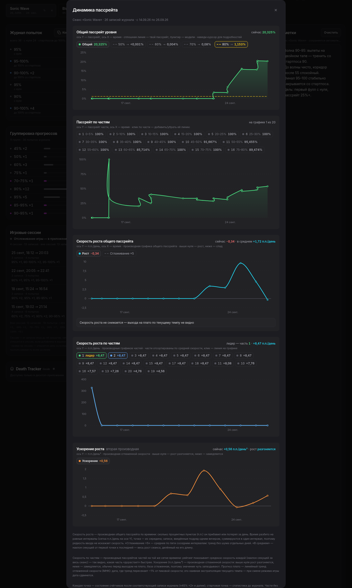

**UI:** кнопка «Графики динамики» в ряду действий ввода → широкая модалка
`DynamicsPanel` с пятью графиками: «Общий пассрейт уровня», «Пассрейт по
частям», «Скорость роста общего пассрейта» (+ полоса прогноза плато),
«Скорость роста по частям» и «Ускорение роста».

**Как работает.** История пассрейтов **не хранится отдельно** — она точно
реконструируется из журнала (`utils/dynamics.ts`, [инвариант](#35-инвариант-счётчиков--фундамент-всего)):

1. из текущих счётчиков вычитается вклад всего журнала → состояние «до
   журнала» («Начало» или «Добавлено ранее»);
2. записи применяются по одной в хронологическом порядке; после каждой
   известны все счётчики → пассрейты (Формулы 1–2) → точка на графике;
3. последняя точка обязана совпасть с текущей статистикой — встроенная
   самопроверка.

Ось X — время. Записи с v1.10 несут метку `at`; старые записи (без даты)
раскладываются **равномерно между якорями** (создание сеанса слева,
ближайшая датированная запись или «сейчас» справа) — порядок точек точный,
оценивается только расстояние; такие точки помечаются, панель даёт сноску
«У N записей нет даты — положение оценено».

**График 1 — общий пассрейт** (циановая линия с градиентной заливкой, бейдж
«сейчас X%»). Над ним чипы **моделей** (те же 50/60/70/80%, [п. 5.10](#510-модели-общего-пассрейта)):
клик показывает/прячет горизонтальный пунктир `level^n` (цвет чипа = цвет
линии, тултип с формулой). По умолчанию выбрана модель, ближайшая к текущему
пассрейту. Ось Y сама расширяется под выбранную модель (0,8⁴ = 40,96%).

**График 2 — пассрейты частей.** Чтобы 21 линия одного Sonic Wave не
сливалась, линии не «лепятся» все сразу: над графиком — **список-чипсы**
«номер · диапазон · текущий пассрейт» (клик добавляет/убирает; по умолчанию —
часть с максимумом заходов). Цвет линии = позиция в выборе, поэтому выбранные
всегда различимы; при одной выбранной рисуется заливка. Заголовок честно
сообщает «на графике k из N».

**График 3 — скорость роста общего пассрейта** (v1.26) — производная
первого графика: сколько процентных пунктов (п.п.) пассрейт прибавлял или
терял за единицу времени. Осмысленная скорость не зависит от частоты ввода
записей (пять записей подряд за минуту — не всплеск ×1440), поэтому время
разбивается на **равные календарные интервалы**: полночь, час, минута или
понедельник. Скорость интервала — конечная разность общего пассрейта на его
концах, нормированная на единицу; точка ставится в середину интервала
(подсказка показывает описываемый день и записи, попавшие в него). Единица
выбирается по длине сеанса так, чтобы интервалов было не больше 48:
мин (сеанс до 48 минут) → час (до двух суток) → день (до 48 дней) → неделя;
подписи остаются человеческими — «п.п./день», а не «п.п./мин» о полугоде.
Границы ближе 20% единицы к краям сливаются с соседним интервалом —
обрывок «сессия началась в 23:50» не раздувается в гигантский пик.

У графика те же элементы, что у соседей: бейдж «сейчас X · в среднем Y
п.п./день» («сейчас» — последний интервал, «в среднем» — наклон секущей от
первой точки к последней), чипы над графиком и сноска снизу. Значения
бывают **отрицательными** — неудачные попытки увеличивают заходы и снижают
долю прохождений: ось Y расширяется вниз от нуля, ноль подчёркнут заметной
линией, спад в бейджах и подсказках — красным. Чип **«Сглаживание ×5»**
добавляет жёлтую пунктирную линию — центрированное скользящее среднее по
пяти соседним интервалам (у краёв окно усечено): тренд скорости без шума
отдельных дней.

Под графиком — **полоса «Прогноз плато»** (v1.27): по сглаженной скорости
строится линейный тренд (МНК-регрессия скорости на время), и если тренд
убывает, показывается дата, где он пересекает уровень «почти нуля» — 1%
от пиковой скорости: «Прогноз плато: ≈ 01.10.26 (через ~8 дней) — по
текущему темпу скорость роста спадёт почти до нуля к этой дате». Варианты
«уже около нуля — пассрейт вышел на плато» / «скорость не снижается —
плато не прогнозируется» / «мало интервалов» тоже различаются. Это наивная
экстраполяция текущего темпа (тултип честно предупреждает), не обещание.

**График 4 — скорость роста по частям** (v1.27) — производные рядов
графика «Пассрейт по частям» на той же сетке времени: ответ на вопрос
«какая часть „дорастает“ быстрее». Над графиком — **рейтинг-чипсы**,
отсортированные по средней скорости части за весь сеанс (наклон секущей,
п.п./единица): у лидера — пометка «лидер», у части без заходов — «без
заходов». Клик по чипсу добавляет/убирает линию на графике (по умолчанию —
два лидера с заходами); цвета — та же палитра, что у графика частей.
Заголовок справа дублирует лидера: «лидер — часть 2 · +4,9 п.п./день».

**График 5 — ускорение роста** (v1.27) — вторая производная: производная
СГЛАЖЕННОЙ скорости (дифференцировать сырую — значит удвоить шум, поэтому
база сглаженная и значения чуть запаздывают). Единицы — п.п. за единицу
времени ЗА единицу времени («п.п./день²»); выше нуля рост разгоняется,
ниже — замедляется (обычно перед выходом на плато). Бейдж справа — «сейчас
+3,19 п.п./день² · рост разгоняется» (или «замедляется» красным);
подсказка точки показывает, с какой на какую скорость перешли («скорость
+1,38 → +1,6 п.п./день»).

**`LineChart`** — SVG-график без внешних библиотек: неоновые линии со
свечением, сетка, «красивые» деления Y, деления X по времени (от 15 минут до
года — плотность зависит от ширины и минимального зазора подписей 72 px),
точки записей, легенда, наведение — перекрестие и подсказка (дата, запись
журнала, значения всех рядов; до 10 строк + «…и ещё N»). Проп `yAxis`
(множитель `scale`, форматы делений и подсказки) включает произвольную
ось Y со знакопеременными значениями — так график скорости показывает
отрицательные деления и линию нуля, не затрагивая процентные графики.
Высоты графиков адаптивные (`clamp(120px, 32dvh, 230px)`), график никогда не
сжимается flex-ом (`shrink-0`) — на низких окнах всё влезает. `ResizeObserver`
держит отзывчивость; условный рендер легенды учтён (callback-ref).

**Код:** `utils/dynamics.ts` (`computeDynamics`, `effectiveTimes`,
`computeVelocity` — сетка `buildGrid`/`nextBoundary` и `chooseUnit`,
`smoothVelocity`, `computePartVelocities` — скорость по частям со средними
для рейтинга, `computeAcceleration` — вторая производная по сглаженной
скорости, `forecastPlateau` — МНК-тренд и дата выхода на плато),
`components/DynamicsPanel.tsx`, `components/LineChart.tsx`
(`LineChartYAxis`), `components/Modal.tsx` (prop `wide`), кнопка в
`components/AttemptInput.tsx`, подключение в `App.tsx` (`showDynamics`,
`key={active.id}` — сброс выбора при смене сеанса).

### 5.13 Игровые сессии

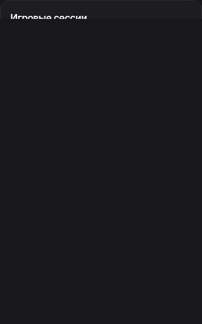

**UI:** панель `GameSessionsPanel` в левом aside (под группировкой) + компактный
бейдж статуса игры в шапке приложения («Игра запущена · 12 мин» с тикающей
длительностью).

**Как работает.** Игровая сессия — интервал `[startedAt, endedAt]` от запуска
до закрытия Geometry Dash (автоматически, v1.12+). Запись журнала попадает в
сессию, если её метка `at` лежит в интервале (границы включительно) —
группировка **постфактум** (`groupLogByGameSessions`), поэтому модель данных
не меняется и всё работает для старых записей; записи вне запусков игры
считаются «вне сессий» и видны отдельной строкой.

**Обнаружение запуска/закрытия** — `electron/gameWatcher.cjs` в main-процессе:
опрос списка процессов (Steam-сборка на Windows — `GeometryDash.exe`; macOS —
`ps comm`; Linux — игра в Proton и видна только в полной команде `ps args`).
Матчер ищет `geometrydash` / `geometry dash`, но пробельная форма не
считается на Linux (ложные срабатывания от открытых папок в файловых
менеджерах). Опрос асимметричный (п. 3.7): 2 с вне игры / 20 с во время игры,
с фильтром `/FI IMAGENAME` и лестницей стратегий — сбои не роняют
приложение, при 5+ сбоях подряд приходит событие `health { degraded: true,
detail }` — панель показывает янтарное «Отслеживание приостановлено» с
точной диагностикой (какие команды, коды выхода, stderr), при восстановлении
— «отслеживание возобновлено».

**Стык жизненного цикла.** При старте трекера восстановленная из сохранения
открытая сессия сверяется с реальностью: игра не запущена → сессия
закрывается; запущена, но `since − startedAt > 6 ч` (трекер стоял закрытым, а
игра успела перезапуститься) → старая закрывается, открывается новая; иначе —
та же непрерывная сессия продолжается. История ограничена 100 последними
сессиями (`MAX_GAME_SESSIONS`). Строки панели: дата, «→ идёт» / время
закрытия, длительность (тикает раз в 5 с, спит при скрытом окне), «N записей
· M попыток», сводка групп «37% ×1»; открытая сессия всегда сверху, даже
пустая; показывается до 12 строк + «и ещё N». Клик по строке открывает
[окно сессии](#514-окно-игровой-сессии).

В веб-версии мостов нет: бейдж показывает «отслеживание игры — в
приложении», но сессии, записанные в приложении, видны и в браузере (для
тестов есть скрытый симулятор `window.__gdGameSim`).

**Код:** `electron/gameWatcher.cjs`, `electron/main.cjs`,
`electron/preload.cjs`, `src/utils/gameWatch.ts` (стор статуса,
`groupLogByGameSessions`, форматтеры), `components/GameSessionsPanel.tsx`
(+ `GameStatusBadge`, хук `useGameNow`), `App.tsx` (подписка, сверки,
`SESSION_MERGE_WINDOW_MS`).

### 5.14 Окно игровой сессии

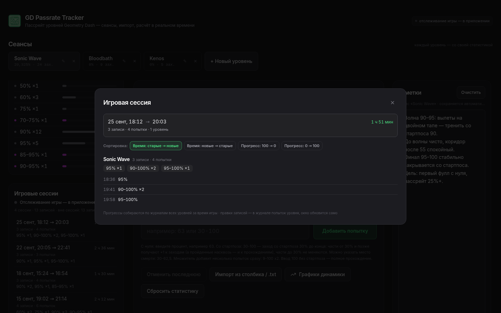

**UI:** клик по строке панели «Игровые сессии» → модалка
`GameSessionDetailModal` (широкая, Esc/фон закрывают).

**Как работает.** Окно показывает **все прогрессы одного запуска игры по
всем уровням** (запуск игры может накрыть несколько сеансов трекера —
`collectGameSessionProgress` собирает записи всех сеансов с меткой `at` в
интервале; уровни без записей не показываются, сортировка уровней — по
последней записи). Шапка: интервал («21 сент, 21:04 → 22:48» или «идёт
сейчас»), длительность, «N записей · M попыток · K уровней». По каждому
уровню: имя, счётчики, **чипы группированных прогрессов** («45–100% ×1 …» —
та же группировка, что в п. 5.6) и **полный хронологический список** записей
со временем «HH:MM».

Окно **живое** (v1.20): длительность открытой сессии тикает; новые записи,
добавленные при открытом окне, появляются сразу (окно читает данные из
состояния App, а не снапшот); закрытие игры при открытом окне переводит шапку
в «завершена». Если сессия выпала из истории (лимит 100) — окно закроется
само. Пустые состояния предусмотрены для открытой и закрытой сессий.

**Код:** `src/utils/gameWatch.ts` (`collectGameSessionProgress`),
`components/GameSessionDetailModal.tsx`, `components/GameSessionsPanel.tsx`
(строки-кнопки, `onOpenSession`), `App.tsx` (`detailGameSessionId`).

### 5.15 Сортировка прогрессов в окне сессии

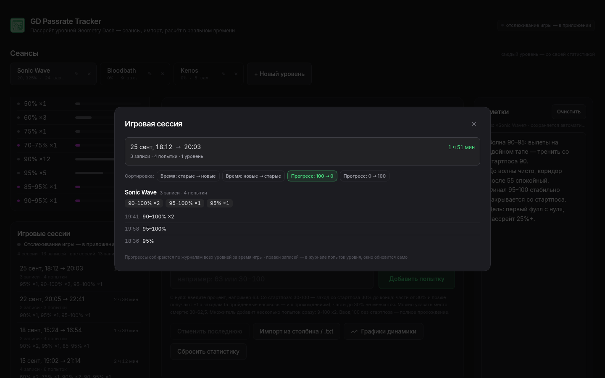

На мобильном (390×844) тулбар сортировки переносится на несколько строк
без наложений:

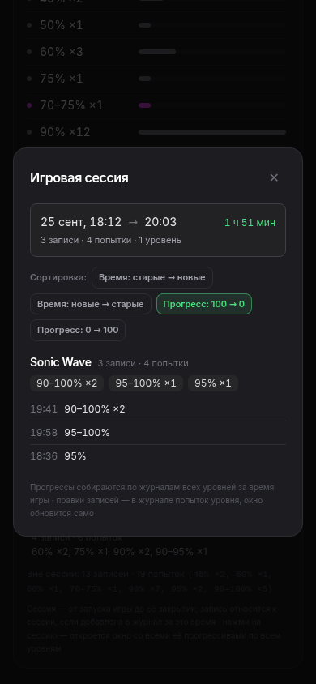

**UI:** тулбар под шапкой окна сессии (v1.21) — четыре кнопки:
«Время: старые → новые» (умолчание) · «Время: новые → старые» ·
«Прогресс: 100 → 0» · «Прогресс: 0 → 100».

**Как работает.** Режим применяется к **каждому уровню** окна одинаково: к
списку записей и к чипам сводки. Ключ прогресса — конец рана `to`; при
равном `to` выше ставится ран с **меньшим** `from` (раны с нуля — выше
стартпосовых: пройти с нуля до 63% «тяжелее», чем с 30%); при полном равенстве
`(from, to)` — по времени добавления. Сортировка стабильная и немутирующая
(`slice()` + `sort`, вход не меняется). В режимах времени чипы остаются в
каноническом порядке группировки, в режимах прогресса идут в ту же сторону,
что и список. Режим живёт в окне: закрыл и открыл — снова хронология
(запоминание между открытиями — кандидат в будущие правки, подъём state в
App). Live-обновление сохраняется: новая запись появляется сразу на своей
позиции сортировки.

**Код:** `src/utils/gameWatch.ts` (`GameSessionSortMode`,
`GAME_SESSION_SORT_MODES`, `sortGameSessionEntries`,
`orderGameSessionGroups`, `sortAt`), `components/GameSessionDetailModal.tsx`
(тулбар, `useState<GameSessionSortMode>('time-asc')`).

### 5.16 Синхронизация с Death Tracker (Geode)

**UI:** панель `DeathTrackerSync` в левом aside: выбор папки сейвов мода
(диалог / автопоиск), список найденных уровней с поиском, привязка уровня к
сеансу, тумблеры настроек, лента последних событий (8), кнопка «Импортировать
всю историю уровня».

**Как работает.** Мод [Death Tracker](https://geode-sdk.org/mods/elohmrow.death_tracker/)
пишет статистику каждого уровня в отдельный JSON внутри своей папки
(по умолчанию `%LOCALAPPDATA%\GeometryDash\geode\mods\elohmrow.death_tracker\levels`)
и **перезаписывает файл при каждой смерти/ране** — наблюдение за папкой даёт
поток событий в реальном времени, сам мод менять не нужно. Формат файла
(v2.4.5): `deaths: { "63": 5 }` — попытки с нуля, `runs: { "30-100": 11 }` —
раны со стартпозов, плюс агрегаты (`newBests`, `currentBest`, `sessions`…).

Соответствие модели трекера:

| В моде | В трекере |
|---|---|
| `deaths["63"] = 5` | попытки «63%» ×5 (с нуля; `"100"` — фулл) |
| `runs["30-100"] = 11` | раны «30–100%» ×11 |
| `runs["0-45"]` | практика «с нуля» — НЕ реальная попытка, пропускается |
| `runs["25-40"]`, где 25 — не стартпос сеанса | практис-ран с чекпоинта — пропускается (фильтр настраивается) |

Мод хранит **агрегаты**, а не хронологию, поэтому синхронизация — дифф
снапшотов: в привязке (`Session.dtSync.seen`) запоминается «увиденное»
состояние счётчиков, новые попытки = текущее состояние минус увиденное
(дифф считается в renderer, `utils/dtSync.ts` — main файлы только читает).
Привязка фиксирует момент «синхронизировать с текущего»; вся история мода до
привязки не импортируется автоматически — для этого кнопка «Импортировать всю
историю» (читает файл через `gdDT:readLevel` и раскладывает счётчики в журнал
записями `×N`).

Настройки (`DtBridgeConfig`, глобальные): папка сейвов, «наблюдение
включено» (события применяются автоматически — при гринде не нужно трогать
трекер вообще), «учитывать раны со стартпозов», «только раны со стартпосов
сеанса» (фильтр практики: в моде стартпос-раны и практис-раны неразличимы),
автопривязка сеанса к уровню по совпадению имён. Поиск уровня при привязке —
компонент `LevelSearchSelect`: фильтрация по мере набора, навигация стрелками,
до 60 строк без прокрутки.

События моста склеиваются в записи «×N» (несколько смертей между сканами —
одна запись с множителем); счётчики мода только растут, поэтому дифф по
снимкам корректен даже если часть событий пришла, пока трекер был закрыт
(catch-up при старте). Панель доступна только в приложении — в браузере
честно сообщает об этом.

**Код:** `src/utils/dtSync.ts` (парсинг, `diffDtState`, фильтры, каноникализация
имён), `electron/main.cjs` (fs.watch, дебаунс-скан 1000 мс, перескан 15/5 с,
`autoscan` по типичным путям Geode, обрезка IPC-пейлоада), `electron/preload.cjs`
(`window.gdDT`), `components/DeathTrackerSync.tsx`, `components/LevelSearchSelect.tsx`,
`App.tsx` (`applyDtEvent`, `handleDtLink`, `handleDtImportHistory`, лента `dtFeed`).

### 5.17 Заметки уровня

**UI:** `NotesPanel` — правый aside (на широких экранах своя колонка, прилипает
при прокрутке): свободный текст «планы, сложные места, что тренировать»,
счётчик символов, автосохранение.

**Как работает.** Текст хранится в `Session.notes` (с v1.9), сохраняется вместе
со всем состоянием с тем же дебаунсом. Переживает всё: пересоздание частей,
сброс статистики, «Отменить» (undo не знает про заметки намеренно) — удаляется
только вместе с сеансом. Debounce ввода не даёт дёргать persist на каждую
букву. На `lg`-экранах панель переезжает под контент на всю ширину — верстка
не ломается на промежуточных ширинах.

**Код:** `components/NotesPanel.tsx`, `App.tsx` (`handleNotesChange`).

### 5.18 Blitzkrieg — тренировка кусковыми стадиями

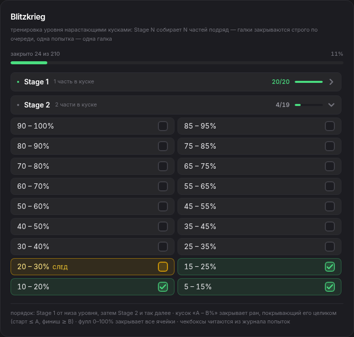

**UI:** панель `BlitzkriegPanel` под картой уровня: общий прогресс «закрыто X
из Y» с неоновой полосой, список стадий Stage 1…n — каждая разворачивается
кликом по заголовку (шеврон). Внутри стадии — ячейки «A – B%» с чекбоксами:
закрытые — неоново-зелёные, следующая галка порядка — янтарная с меткой
«след». Раскрыта по умолчанию «текущая» стадия — первая с незакрытыми
ячейками; когда она закрывается целиком, панель сама переходит к следующей.
Под заголовком — переключатель порядка закрытия галок (с v1.31): чипы
**«по очереди»** (по умолчанию) и **«в любом порядке»** (v1.31.1 — в рамках
текущей стадии); настройка глобальная, хранится в localStorage
(`gd-passrate-tracker.blitz-order`) и переживает перезагрузку (значение
`'any'` из v1.31.0 при загрузке мигрирует в `'stage'` — выбор «не строгая
очередь» не теряется).

**Как работает.** Разбивка уровня на части даёт границы 0, …, 100. Stage s —
все куски из s ПОДРЯД идущих частей: Stage 1 — по одной части («87–100,
84–87, …, 0–4»), Stage 2 — по две («84–100, 81–87, …, 0–9»), …, Stage n —
весь уровень одним куском 0–100. Кусков в стадии s ровно n − s + 1, всего
ячеек n(n+1)/2.

Порядок закрытия галок — по переключателю (v1.31). **«По очереди»**
(по умолчанию, правило v1.29): галки закрываются **строго по очереди** —
сначала Stage 1 от НИЗА уровня (0–4, 4–9, …), затем Stage 2 от низа — и
так до конца. Одна попытка журнала закрывает **ровно одну** галку —
следующую незакрытую, если ран покрывает её целиком: старт ≤ A и финиш ≥ B
(смерть ровно на B% доехала до конца вплотную — закрывает). Два следствия
из практики:

- **«Счастливый» ран не открывает дальние стадии.** На Stage 1 при
  незакрытой галке 0–4% ран 0–17% закрывает именно 0–4%, а не галку 0–17%
  третьей стадии: галки следующих стадий не засчитываются, пока не закрыта
  текущая.
- **Ран, покрывающий несколько галок, закрывает соседнюю.** После закрытой
  10–30% ран 10–58% закрывает 20–40%, а не 30–50% — по одной галке на
  попытку.

Ран, не покрывающий следующую галку, не закрывает ничего — даже если
покрывает дальние куски своей или следующих стадий. Запись ×N — N попыток,
каждая закрывает свою галку (0–17% ×3 при частях 0–4/4–9/9–17 закрывает
0–4, 4–9 и 9–17).

**«В любом порядке»** (v1.31.1 — в рамках ТЕКУЩЕЙ стадии): стадии идут
по очереди — «текущая» первая с незакрытыми галками, — но внутри неё
порядок не важен: попытка закрывает **каждую** галку текущей стадии,
которую её ран покрывает целиком. «Счастливый» ран 0–17% при частях
0–4/4–9/9–17 закрывает сразу 0–4, 4–9 и 9–17 — всю Stage 1, — но НЕ
трогает 0–9 и 4–17 второй стадии: галки следующих стадий не
засчитываются, пока текущая не закрыта целиком, и ран, закрывший
последнюю галку стадии, на следующую не переносится (следующие попытки
работают уже с ней). Дальние куски текущей стадии закрываются раньше
нижних — ран 9–17% закроет галку 9–17, даже если 0–4% ещё открыта.
Галки ещё не открытых стадий в панели приглушены, тултип ждущей галки
объясняет, что сначала закрывается текущая. Очереди нет — янтарной
подсветки «след» в этом режиме нет, а тултип открытой ячейки объясняет,
какой ран её закроет. Запись ×N учитывается каждой покрытой галке
текущей стадии (×3 на покрытом куске — passes 3; после полного закрытия
стадии следующие попытки той же записи работают уже со следующей
стадией).

Фулл 0–100% — исключение в обоих режимах: он доказывает каждый кусок и
закрывает все ячейки разом — из какой бы стадии они ни были. «Добавлено
ранее» старше журнала и считается консервативно в обоих режимах: фуллы
закрывают все галки, стартпос-фуллы — только кусок последней части,
заходы с нуля — никакие; журнал после него работает от новой «текущей»
стадии. Прогресс нигде не хранится отдельно: чекбоксы всегда выводятся
из журнала попыток на лету, тултип ячейки показывает, каким раном она
закрыта.

**Код:** `src/utils/math.ts` (`buildBlitzkrieg`, `BlitzChunk`/
`BlitzStage`/`BlitzPlan`, `BlitzOrderMode`), `components/BlitzkriegPanel.tsx`
(переключатель порядка — чипы `OrderChip`, приглушение галок неоткрытых
стадий), `App.tsx` (useMemo-план, состояние порядка с сохранением и
миграцией `'any'` → `'stage'`). Тесты: `test-blitz-seq.ts`,
`test-blitz-stage.ts`.

---

### 5.19 Сохранение сеанса в файл (экспорт .md / .txt / .json)

Кнопка «Сохранить сеанс в файл» (со значком-стрелкой вниз) в панели «Новая
попытка» открывает окно экспорта: выбор формата — `.txt`, `.md` или `.json` —
с живым предпросмотром отчёта, кнопка «Скачать» и «Копировать текст отчёта»
(с запасным вариантом для старых буферов обмена). Имя файла
`GD-Passrate-<уровень>-<дата>.<ext>`, дата — момент выгрузки.

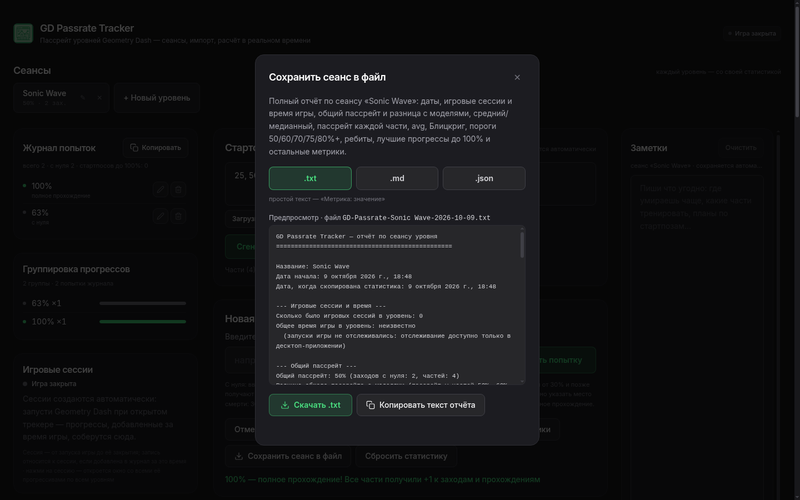

Отчёт собирается на лету из текущего сеанса и содержит: название и дату
начала сеанса, дату копирования; число игровых сессий с прогрессами по этому
уровню, общее время игры в уровень, суммарные попытки/фуллы; общий пассрейт
и его разницу с моделями (пассрейт частей 50/60/70/80%); средний и медианный
пассрейт на часть (с min/max-частями); пассрейт каждой части; avg на
50/60/70/100% и блок 0–50/0–70; стадии Blitzkrieg; счётчики 50%+/60%+/
70%+/75%+/80%+; ребиты (фуллы − 1), лучшие прогресс до 100% и историю
рекордов, средние прохождения частей по игровым сессиям, динамику по дням,
заметки и настройки Death Tracker; в `.json` дополнительно вкладывается
полный бэкап сеанса (Session целиком).

**Код:** `src/utils/export.ts` (`buildSessionReport`,
`reportToText` / `reportToMarkdown` / `reportToJson`, `downloadReport`),
`components/ExportModal.tsx`, кнопка в `components/AttemptInput.tsx`,
состояние `showExport` в `App.tsx`. Работает и в браузере, и в Electron —
выгрузка через Blob + `<a download>`.

---

## 6. Формат сохранения

**Хранилище** — `localStorage` окна (профиль приложения, [п. 2.5](#25-где-хранятся-данные)),
ключ `gd-passrate-tracker.v2`. Структура значения:

```jsonc
{
  "sessions": [ /* Session[] — сеансы уровней целиком */ ],
  "activeId": "…",           // какой сеанс открыт
  "dtBridge": { /* DtBridgeConfig | null — настройки моста мода */ },
  "gameSessions": [ /* GameSession[] — запуски игры, ≤100 последних */ ]
}
```

**Миграции — «мягкие»**: формат v2 не менялся деструктивно с v1.1; все
появлявшиеся поля — необязательные, при загрузке достраиваются:

| Поле | Появилось в | Миграция старого сохранения |
|---|---|---|
| `Session.fullClears` | v1.3 | из `clears` последней части (раньше фуллы оттуда и брались) |
| `Session.log` | v1.4 | пустой список; накопленное показывается как «Добавлено ранее» |
| `AttemptSpec.at` | v1.10 | отсутствует у старых записей → графики оценивают положение (п. 5.12) |
| `Session.dtSync` | v1.7 | нет привязки — панель предлагает привязать |
| `Session.notes` | v1.9 | пусто |
| `gameSessions` (глобально) | v1.12 | пустой список — запись начнётся с ближайшего запуска игры |
| ключ v1 → v2 | v1.1 | старое одиночное сохранение мигрирует в сеанс «Мой уровень» при загрузке |

**Защита при загрузке**: каждая запись проверяется структурно (`isSession`,
`isPart`, `isLogEntry`, `isGameSession`); `gameSessions` сортируются по
`startedAt` и обрезаются до 100. Запись происходит трейлинг-дебаунсом
2 с (10 с при скрытом окне) с мгновенным флашем на `pagehide` /
`beforeunload` / `visibilitychange(hidden)` — [п. 3.7](#37-производительность-и-стабильность).
Undo-стек в сохранение не пишется (живёт в памяти окна, до 50 шагов).

---

## 7. Тесты

Логика покрыта автотестами (349 проверок: 164 из исходного проекта + 14 за
медиану v1.28 + 63 за порядок галок v1.29 + 108 за режим «в любом порядке
в рамках стадии» v1.31.1, все зелёные). Тесты живут в
`scripts/` рядом с проектом (в архив не входят): старые — Node-скрипты,
которые бандлят тестируемый TS-модуль через esbuild; новые (.ts) — импортируют
модуль напрямую (Node ≥ 23 умеет type stripping):

| Скрипт | Проверок | Что покрывает |
|---|---|---|
| `test-avg-part-passes.cjs` | 54 | правило «часть от нуля» (границы, стартпосы, ×N), усреднение по игровым сессиям (открытая/закрытая, вне-сессийные записи, немутация) |
| `test-game-watcher.cjs` | 24 | матчер процессов всех платформ (вкл. защиту от ложных срабатываний Proton-путей), живая интеграция: процесс-приманка → started → kill → stopped |
| `test-game-watcher-robustness.cjs` | 11 | бэкофф 2→30 с, ошибки не роняют промис, старт/стоп без утечек таймеров |
| `test-game-watcher-windows-path.cjs` | 33 | лестница стратегий опроса, фильтр `/FI IMAGENAME`, диагностика ошибок (код выхода/таймаут/stderr, CP866) |
| `test-game-session-detail.cjs` | 18 | сбор прогрессов окна сессии: границы интервалов включительно, сортировка уровней, немутация |
| `test-game-session-sort.cjs` | 24 | 4 режима сортировки, tie-break'и (равный `to`, меньший `from`, время), стабильность, немутация |
| `test-median.ts` | 14 | медианный пассрейт на часть (Формула 2б): нечётный/чётный ряд, пустой список, нули, одна часть, инвариант AM≥GM |
| `test-blitz-seq.ts` | 63 | порядок закрытия галок Blitzkrieg «по очереди» (v1.29): оба примера постановки («счастливый» ран не открывает следующие стадии; ран, покрывающий несколько галок, закрывает соседнюю), ×N, фуллы, «Добавлено ранее», курсор минует закрытые «раньше», немутация |
| `test-blitz-stage.ts` | 108 | режим «в любом порядке» в рамках текущей стадии (v1.31.1): «счастливый» ран 0–17% закрывает всю Stage 1 (3 из 10, а не 6), галки следующих стадий не считаются (0–9/4–17/0–17 открыты), граница стадий (ран, закрывший последнюю галку стадии, не переносится на следующую), дальние куски текущей стадии раньше нижних, ×N переводит стадию по попыткам, фуллы, «Добавлено ранее», умолчание = «по очереди» (регрессия), немутация |

Запуск: `node scripts/test-<имя>.cjs` (нужен `esbuild` — `npx esbuild`) и `node scripts/test-<имя>.ts` (Node ≥ 23, без сборки).
Помимо автотестов, каждая фича проходила ручную верификацию на
production-сборке (`vite preview` + headless-браузер: инжект сохранений,
симулятор `__gdGameSim`, DOM-метрики вёрстки на 1440/942/390 px, скриншоты);
целостность архива проверяет `scripts/package-zip.sh` (40 проверок: версия,
свежесть бандла, наличие компонентов, `require` electron-модулей).

---

## 8. История версий

| Версия | Что появилось |
|---|---|
| 1.0–1.9.1 | Исходный проект: формулы 1–3, сеансы уровней, журнал попыток, «Добавлено ранее», мост Death Tracker, заметки |
| 1.10.0 | Блок моделей (50/60/70/80%), группировка прогрессов, графики динамики пассрейта |
| 1.11.0 | Пунктирные модели на графике общего пассрейта — выбор чипами |
| 1.12.0 | Игровые сессии: автоопределение запуска/закрытия Geometry Dash |
| 1.13.0 | Стабильность: без GPU-ускорения, окно журнала 150 записей, бэкофф опроса |
| 1.13.1 | Абсолютный путь tasklist, состояние «отслеживание приостановлено» |
| 1.14.0 | Лестница стратегий опроса процессов + подробная диагностика сбоев |
| 1.15.0 / 1.15.1 | Асимметричный опрос игры; дебаунсы сохранения и скана мода |
| 1.16.0 → 1.17.0 | Панель средних (семантика уточнялась по ходу: «доходы» → «прохождения» → «части от нуля») |
| 1.18.0 | Средние считаются по игровым сессиям активного уровня |
| 1.19.0 | Опрос 20 с + фильтрованный tasklist во время игры, потолок V8-кучи 256 МБ |
| 1.20.0 | Окно игровой сессии: все прогрессы запуска по всем уровням, live-обновление |
| 1.21.0 | Сортировка прогрессов в окне сессии: 4 режима, чипы в ту же сторону |
| 1.25.0 | Средний пассрейт на часть (Формула 2а): среднее арифметическое пассрейтов всех частей — панель под общим пассрейтом, min/max-части, полоса среднего |
| 1.26.0 | Скорость роста пассрейта — третий график в «Динамике»: производная общего пассрейта по равной временной сетке (мин/час/день/нед), сглаживание ×5, знакопеременная ось Y в LineChart |
| 1.27.0 | Аналитика роста: скорость по отдельным частям с рейтингом «кто дорастает быстрее», прогноз даты выхода на плато (МНК-тренд сглаженной скорости) и ускорение — вторая производная (п.п./ед.²) |
| 1.27.1 | Логотип в шапке — теперь иконка приложения (favicon.svg) вместо встроенного SVG; путь «./favicon.svg» корректен для dev-сервера, сборки и Electron (file://) |
| 1.27.2 | Сборка Windows без WASM-конвертации иконки: в проекте лежит готовый многослойный `build/icon.ico` (16–256), `win.icon` указывает на него — исправлен крах `npm run dist:win` «WebAssembly.Memory(): could not allocate memory» (конвертер выделял 1 ГБ WebAssembly-памяти) |
| 1.28.0 | Медианный пассрейт на часть (Формула 2б): серединное значение ряда пассрейтов — на одной панели со средним (две карточки рядом с общими ячейками min/max-частей и «частей с заходами»); разрыв среднего и медианы — маркер асимметрии сложности |
| 1.29.0 | Blitzkrieg: галки закрываются строго по очереди — одна попытка закрывает ровно одну галку, следующую незакрытую (Stage 1 от низа уровня, затем Stage 2 и так далее); «счастливый» ран 0–17% при незакрытой 0–4% закрывает именно её, а не галки следующих стадий; ран, покрывающий несколько галок, закрывает соседнюю (после 10–30% ран 10–58% закрывает 20–40%, а не 30–50%); подсветка следующей галки янтарным, тултип «какой ран закрыл»; README-раздел 5.18 (панель появилась в v1.24) |
| 1.31.0 | Blitzkrieg: переключатель порядка закрытия галок — чипы «по очереди» (по умолчанию, правило v1.29) и «в любом порядке» (как в v1.24–1.28): попытка закрывает каждую галку, которую её ран покрывает целиком, порядок стадий не важен, подсветки «след» нет; настройка глобальная (localStorage `gd-passrate-tracker.blitz-order`), переживает перезагрузку; подписи/тултипы панели зависят от режима, умолчание — «по очереди» (регрессия покрыта тестами); README 5.18 дополнен, `BlitzOrderMode` в math.ts, тесты `test-blitz-any.ts` (62 проверки) |
| 1.31.1 | Blitzkrieg: поведение режима «в любом порядке» уточнено — В РАМКАХ ТЕКУЩЕЙ СТАДИИ: стадии идут по очереди («текущая» — первая с незакрытыми галками), внутри неё порядок не важен — попытка закрывает каждую галку текущей стадии, которую ран покрывает целиком; галки следующих стадий не засчитываются, пока текущая не закрыта целиком, и ран, закрывший последнюю галку стадии, на следующую не переносится (ран 0–17% при частях 0–4/4–9/9–17/17–100 закрывает 0–4, 4–9 и 9–17 — 3 из 10, а не 6, как в v1.31.0); галки неоткрытых стадий приглушены с тултипом «ждёт своей очереди»; localStorage-значение `'any'` v1.31.0 мигрирует в `'stage'`; тесты `test-blitz-stage.ts` (108 проверок, вместо `test-blitz-any.ts`) |
| 1.32.0 | **Сохранение сеанса в файл**: кнопка «Сохранить сеанс в файл» в панели «Новая попытка» → окно экспорта с выбором формата `.md` / `.txt` / `.json`, живым предпросмотром, скачиванием (`GD-Passrate-<уровень>-<дата>.<ext>`) и копированием текста отчёта; отчёт — полная выгрузка статистики сеанса: название и даты, игровые сессии и время игры в уровень, общий пассрейт и разница с моделями 50/60/70/80%, средний/медианный пассрейт на часть, пассрейт каждой части, avg 50/60/70/100%, участки 0–50/0–70, стадии Blitzkrieg, счётчики 50/60/70/75/80%+, ребиты, лучшие прогресс и история рекордов, средние по игровым сессиям, динамика, заметки, DT-настройки; в `.json` вложен полный бэкап Session (README п. 5.19); также перенесены фиксы устойчивости из веб-версии: NotesPanel/LevelSearchSelect/DynamicsPanel (аккуратнее с эффектами и ранним выходом) |
